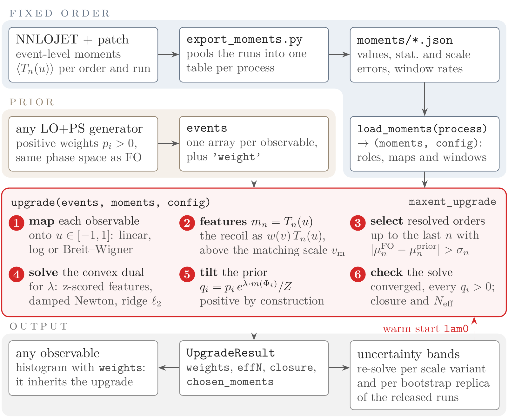

# maxent_upgrade

**Positive-weight event samples that carry fixed-order (NLO, NNLO) information, by reweighting
a parton-shower sample you already have.**

`maxent_upgrade` takes two inputs:
- a positive-weight LO+PS sample, the *prior*;
- a handful of event-level Chebyshev moments from a fixed-order calculation.

It returns new per-event weights that reproduce those moments. The weights come from the
maximum-entropy exponential tilt of the prior, so every weight is positive by construction.
No event is generated and no weight changes sign. The fixed-order moments behind every
application of the papers are released here, so you can upgrade your own prior today.



*One call: map, features, select, solve, tilt, check. The uncertainty bands re-run the same
call, warm-started, once per scale choice and once per bootstrap replica of the released
fixed-order runs.*

---

## Install

Pure Python plus NumPy (Python ≥ 3.9). From a clone:

```bash
pip install .            # or: pip install -e .   (the released tables are installed with the package)
```

## Quick start: your prior, the released moments

```python
import numpy as np
from maxent_upgrade import upgrade, load_moments

moments, config = load_moments("dy")      # Drell-Yan at NNLO: the paper's constraint set
events = dict(np.load("my_prior.npz"))    # arrays mll, y_abs, pT_ll, ... and positive 'weight'
result = upgrade(events, moments, config)
print(result.describe())                  # what was imposed, how well it closed, what it cost
w = result.weights                        # positive, sum to one; histogram any observable with them
```

Command-line versions of the same steps:

```bash
python moments/load_moments.py dy                                # which arrays your events must carry
python examples/upgrade_with_released_moments.py dy my_prior.npz # writes my_prior_dy_upgraded.npz
python examples/bands_with_released_moments.py dy my_prior.npz   # scale and bootstrap variants
```

The released processes are:

| key | process |
|---|---|
| `dy` | Drell-Yan |
| `wp`, `wm` | W+, W- |
| `aa` | diphoton |
| `ggh` | gluon-fusion Higgs |
| `zj` | Z+jet at NLO |

Details are in [`moments/README.md`](moments/README.md).

## What you need, what you get

**You need**
- A positive-weight LO+PS sample of the process. It must store, per event, the observables the
  constraint set names, inside the same fiducial selection as the fixed-order input. For the
  released tables, the lepton observables are Born-level (lepton plus its own QED radiation)
  and the decay angles are Collins-Soper angles (the absolute value \|cos θ*\| for the Z and
  the photon pair, the signed angle of the charged lepton for the W; see `moments/README.md`).
- Event-level moments from a fixed-order code at the target order, with their Monte Carlo and
  scale errors. They must be computed with the same maps and window as on the prior side.
  Either take the released tables, or compute your own
  ([`MOMENT_CONSTRUCTION.md`](MOMENT_CONSTRUCTION.md)).

**You get**
- Strictly positive weights, by construction: q = p · exp(λ·m)/Z.
- The Born observables (masses, rapidities, decay angles) reproduced at the accuracy of the
  input over their full range.
- The recoil (the transverse momentum of the color singlet) reproduced at the accuracy of the
  input above the matching scale. From an inclusive NNLO calculation that accuracy is
  NLO(V+jet), because a recoil needs a real emission.
- Below the matching scale, the shower's spectrum kept as it is, up to the overall
  normalization.
- Every other observable, a *follower*, moving only through its correlation with the
  constrained ones in the prior. A follower that the constraints do not reach keeps the
  prior's accuracy.

**You do not get**
- Events where the prior has none. The tilt moves weight, it never creates it.
- Fixed-order accuracy in followers that do not correlate with the constraints.

The statistical price is the Kish effective sample size, reported as `result.effN` and
`result.effN_retained`. For the paper's priors it is 97.2% (Drell-Yan) and 98.0% / 99.4%
(W+ / W-). The merged diphoton prior keeps 94.5% of its own effective count.

## How it works (the six steps of the figure)

1. **Map** each constrained observable onto u ∈ [-1, 1]: linear (rapidities, angles),
   logarithmic (transverse momenta, continuum masses) or Breit-Wigner (resonant masses).
2. **Features.**
   - A Born observable contributes its *tower* T_1(u) … T_N(u), the Chebyshev polynomials up
     to a depth N.
   - A recoil observable contributes w(v) T_n(u) and w(v). Here w is the C² *window*: it rises
     from the matching scale v_m to 2 v_m and is cut at 500 GeV (1000 GeV for the Higgs and the
     jets). The term w(v) carries the window rate r.
   - Joint moments (optional) contribute products of two towers.
3. **Select.** Each tower is imposed up to its highest order n whose shift the input resolves,
   SNR_n = |μ_n^FO − μ_n^prior| / σ_n > 1, where σ_n is the Monte Carlo error combined with
   the scale envelope. Interior orders below 1 stay in the tower. Their targets agree with the
   prior within the error, so imposing them holds those moments where both put them.
4. **Solve** the convex dual for the multipliers λ.
   - The features are z-scored, the dual is minimized by damped Newton steps, and a ridge
     `L2 = 1e-4` stabilizes the numerics (it is not a statistical weight).
   - The minimum is unique.
   - It takes seconds to a minute for 10⁶ events.
5. **Tilt** the prior: q_i = p_i exp(λ·m(Φ_i)) / Z.
6. **Check** that every q_i > 0, the closure of every moment (also in units of its error),
   and the effective statistics. `result.describe()` prints all of it.

The construction, its accuracy, and the rule that places the matching scale
(α_s(p_T) ln²(Q/p_T) < 0.2) are in the paper.

## The released moments

| key | process (fiducial) | order, runs | constraint set imposed in the paper | also in the table |
|---|---|---|---|---|
| `dy` | pp → Z/γ* → ℓℓ, 13 TeV, ATLAS | NNLO, 298 | m_ll (BW, 12), \|y_ll\| (lin, 12); p_T^ll window 30→60 GeV, cut 500 (log, 20 + rate) | \|cos θ*\| (lin [0, 1], 6); joint m_ll × \|cos θ*\| (16); lepton p_T reference towers |
| `wp`, `wm` | pp → W± → ℓν, 7 TeV, ATLAS | NNLO, 40 each | m_W (BW, 12), \|y_W\| (lin, 12); p_T^W window 25→50 GeV, cut 500 (log, 20 + rate) | decay-angle window (flat for \|cos θ*\| < 0.6, zero at 0.7; 6 + rate); full-range signed angle (8); joint p_T^W × cos θ* (16) |
| `aa` | pp → γγ, 8 TeV, ATLAS | NNLO, 40 | m_γγ (log, 6), \|cos θ*\| (lin, 6); p_T^γγ window 28→56 GeV, cut 500 (log, 12 + rate) | |
| `ggh` | gg → H, 13 TeV, inclusive | NNLO, 40 | \|y_H\| (lin, 6); p_T^H window 37→74 GeV, cut 1000 (log, 12 + rate) | |
| `zj` | pp → Z(→ℓℓ) + jet, 13 TeV, ATLAS, ≥ 1 jet | NLO, 40 | m_ll (BW, 6), \|y_ll\| (lin, 6); p_T^j1 (12) and p_T^j2 (6) windows 30→60 GeV, cut 1000; joint p_T^j1 × p_T^j2 (16) | p_T^j2 to 8 orders; lepton-pair acoplanarity window (12; the paper used 4) |

How the tables are stored:
- Each table is a self-describing JSON file in `moments/` (installed as
  `maxent_upgrade/moments/`) with a CSV copy.
- `moments/<name>_runs.json.gz` holds the channel-summed fixed-order accumulators of every
  independent run at all seven scales, so that any scale choice or any resample of the runs can
  be pooled again (`load_moments(p, scale=k)`, `load_moments(p, runs=...)`).
- Pooling all runs reproduces every released number.

`load_moments` checks each recoil window against the matching-scale rule at the table's hard
scale Q and **prints a warning** on a disagreement. The window is compiled into the
fixed-order run, so the code cannot change it.

**The map and the window are part of the target.** Declaring a different map from the one
compiled into the fixed-order run converges with clean closure onto wrong constraints, and only
a collapsed `effN` betrays it. On the Drell-Yan prior, a linear instead of a Breit-Wigner mass
map gives effN 10.6% instead of 97.2%. Use the `config` that `load_moments` returns.

## The inputs in detail

### `events`

A dict of 1-D arrays of equal length, one entry per event. It holds:
- the strictly positive prior weights under `'weight'` (or `config["weight_key"]`);
- one array per observable named in `config`.

Every other array is a follower. `upgrade` does not use it, and it inherits `result.weights`.
No cuts are applied inside the package: prior and moments must integrate the same phase space.

`upgrade` stops with a message that says what to fix on:
- a missing array;
- unequal lengths;
- non-finite values;
- a constrained observable without moments;
- a recoil window that holds no prior event (a units hint).

It warns when more than 5% of a Born observable lies outside its range (such events are
clipped to the edge on both sides, as in the fixed-order code), and on config keys it does not
read.

### `moments`

Each moment is a weighted sum over the fixed-order phase-space points, one number per order,
never a histogram:

```python
moments = {
  "born":   {"mll":   {"values": [mu_1, ...], "errors": [s_1, ...],      # errors: stat (+) scale
                       "stat_errors": [...], "scale_errors": [...]},     # optional, recommended
             "y_abs": {...}},
  "recoil": {"pT_ll": {"window_values": [mu_1, ...], "window_errors": [...],
                       "rate": r, "x_match": 30., "x_hi": 2500., "soft_lo": 30.,
                       "stat_errors": [...], "rate_stat": ..., "rate_scale": ...}},
  "mixed":  {"ptj1_x_ptj2": {"values": {(1, 1): mu_11, ...}, "errors": {...}, "rate": r}},  # optional
}
```

- **Born:** `values[n-1]` = Σ_j w_j T_n(u(v_j)) / Σ_j w_j over the fiducial region.
- **Recoil:** `window_values[n-1]` = ⟨w T_n(u)⟩ / ⟨w⟩. Here u is the logarithmic map on
  [`soft_lo`, `x_hi`], and w is the window of `config["recoil"][obs]["profile"]` (or the hard
  window [`x_match`, `x_hi`) when no profile is given). The window rate is `rate` = ⟨w⟩ / ⟨1⟩.
- **Errors:** `errors` / `window_errors` are the total fixed-order uncertainties, the run-to-run
  Monte Carlo error combined with the seven-point scale half-range. They decide which orders
  are resolved.
- **Building the dict yourself:**
  - `compute_fo_moments(fo_events, config)` builds it from fixed-order events held in Python
    (window included).
  - `chebyshev_moment(x, w, n_max, lo, hi, map)` is the moment definition itself.

### `config`

```python
config = {
  "born":   {"mll":   {"range": (66., 116.), "map": "bw"},              # "lin", "log", "bw" or ("bw", M, Gamma)
             "y_abs": {"range": (0., 2.4),   "map": "lin"}},
  "recoil": {"pT_ll": {"range": (30., 2500.), "map": "log", "soft_lo": 30.,
                       "profile": {"a": 30., "b": 60., "c": 500.}}},    # window: rises a -> b, cut at c (or falls c -> d)
}
```

| knob | default | meaning |
|---|---|---|
| `moment_selection` | `True` | impose each tower up to its highest order with SNR_n > `snr_threshold`; `False` imposes every supplied order |
| `snr_threshold` | `1.0` | the resolution threshold |
| `fixed_orders` | `None` | `{obs: N}`: impose exactly N orders of a tower; holds band variants to the central constraint set |
| `L2` | `1e-4` | ridge on the dual (numerical stabilizer) |
| `lam0` | `None` | warm start from a previous `result.report["lam"]` |
| `keep_features` | `False` | also return the feature matrix `Phi` and prior `p` in `result.report` |
| `soft_constraints` | `False` | impose each moment with a Gaussian penalty of width its error (`soft_errors="stat"` or `"total"`); see `combine_moments` |
| `weight_key` | `"weight"` | the key of the prior weights in `events` |

## Results

| field | meaning |
|---|---|
| `weights` | the new weights q_i > 0, summing to one |
| `effN` | Kish effective sample fraction 1/(N Σ q_i²) |
| `effN_retained` | Kish(q)/Kish(p): the fraction of the prior's own effective count that the upgrade keeps (equal to `effN` for an unweighted prior; the meaningful number for a sliced or weighted one) |
| `closure` | worst relative deviation of an achieved moment from its target |
| `max_pull` | worst \|achieved − target\| in units of the target's Monte Carlo error |
| `moment_snr` | the resolution spectra SNR_n per tower |
| `chosen_moments` | orders imposed per tower and joint block |
| `x_match` | the matching scale of the first recoil window |
| `report` | multipliers `lam`, targets `mu`, `feature_names`, the per-tower table `towers`, `q_over_p_range`, `moment_selection` |

`result.describe()` prints the per-tower table. `result.summary()` prints one line.

## Uncertainty bands

The bands in the papers are three loops over the same call. They are implemented in
`examples/bands_with_released_moments.py`.

1. **Scale:** re-solve once per scale choice, `load_moments(process, scale=k)` for k = 1..6.
   The per-bin envelope is the band.
2. **Target statistics:** re-solve once per bootstrap replica of the independent fixed-order
   runs, `load_moments(process, runs=rng.integers(0, n_runs, n_runs))`.
3. **Sample statistics:** the usual per-bin error of the weighted events, Σ q_i².

The error bar combines 2 and 3 in quadrature. Every variant uses:
- `fixed_orders` = the central solve's `report["moment_selection"]["chosen"]`, so that it
  imposes the same constraint set;
- `lam0` = the central `report["lam"]`.

For Drell-Yan, the six scale re-solves from the released tables reproduce the paper's band
weights to 3e-5.

## Moments from your own fixed-order code

- [`MOMENT_CONSTRUCTION.md`](MOMENT_CONSTRUCTION.md): the recipe (maps, window, errors, how
  many orders, which calculation each tower comes from).
- [`nnlojet_patch/`](nnlojet_patch/): four patches that make NNLOJET v1.0.2 accumulate
  event-level moments as single-number profile histograms.
- [`runcards/`](runcards/): the NNLOJET run cards of every released table.
- [`export_moments.py`](export_moments.py): pools the runs into the tables
  (`NNLOJET_ROOT=<dir> python export_moments.py dy`).

## Glossary: paper and code

| paper | code |
|---|---|
| prior p_i | `events["weight"]` |
| tower of depth N (moments n = 1..N of one observable) | the lists in `moments`; `n_orders` in a table |
| matching scale v_m | `x_match`; `profile["a"]` |
| window w(v), rising v_m → 2 v_m, cut at c | `config["recoil"][obs]["profile"] = {"a", "b", "c"[, "d"]}`; `profile_w` |
| window rate r = ⟨w⟩ | `rate`, `window_rate` |
| follower (never constrained) | any array in `events` not named in `config` |
| upgraded sample (MaxEnt in figures) | `result.weights` |
| resolution criterion SNR_n > 1 | `moment_selection`, `snr_threshold`, `result.moment_snr` |

## Legacy: histogram input

`upgrade_from_histograms(events, fo_low, fo_high, config)` implements an earlier,
histogram-based variant of the construction:
- binned K-factor targets from two consecutive orders;
- a data-driven matching scale;
- the dials `WSIG`, `RELMAX`, `DELTA`, `CLIP`, `MINSUP`, `RSUP` and `band`.

It is kept for users who have only binned fixed-order output, and was not used for the papers'
results. `examples/example_synthetic.py` shows it. Its helpers are `moment_snr`,
`resolved_order`, `FOHist` and `fo_from_dat`.

## Repository layout

| path | content |
|---|---|
| `maxent_upgrade/` | the package: `__init__.py` (`upgrade` and helpers), `released.py` (`load_moments`), `basis.py` (maps and Chebyshev polynomials), `maxent_match.py` (the solver and the legacy engine) |
| `moments/` | the released tables, their per-run files, and their README |
| `examples/` | `upgrade_with_released_moments.py`, `bands_with_released_moments.py`, `example_moments.py`, `example_diphoton.py` (toy prior), `example_synthetic.py` (legacy) |
| `tests/` | `python tests/test_released.py`, `tests/test_two_recoils.py`, `tests/test_mixed_moments.py` (or `pytest tests/`) |
| `docs/` | the flowchart |
| `nnlojet_patch/`, `runcards/`, `export_moments.py` | the fixed-order side |
| `eventlevel/` | the analysis scripts behind the papers' figures and numbers ([`REPRODUCE.md`](REPRODUCE.md)); they need the event samples and NNLOJET productions, which are not distributed |

## Citation and licence

If you use the package or the released moments, please cite:
- B. Assi, *Maximum-entropy moment matching for color-singlet processes: NNLO information in
  positive-weight event samples*;
- B. Assi, R. Poncelet, J. Whitehead, *Unlocking unlimited perturbative accuracy without
  negative weights*.

MIT licence (see `LICENSE`).
