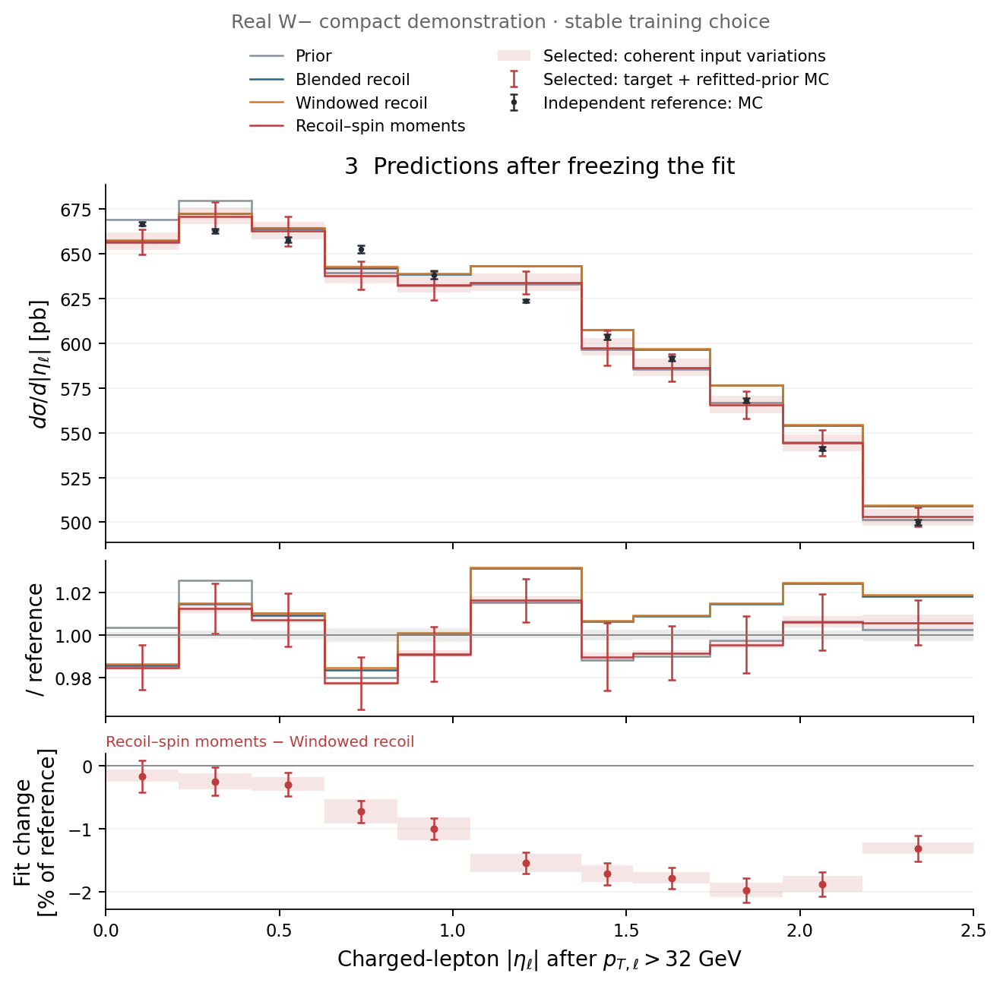

# W spin information and a new lepton selection

The real W example asks whether additional production–decay information is
resolved by the supplied integrals, then predicts lepton observables that were
not fitted. Both charge samples and their complete numerical inputs accompany
the checkout:

```bash
python -m pip install '.[plot]'
python examples/w_constraint_workflow.py wp --output w_plus
python examples/w_constraint_workflow.py wm --output w_minus
```

Open `w_minus/report/report.html`. The training pages distinguish agreement with
the imposed inputs from evidence in the remaining correlations. The prediction
page shows the lepton spectrum after a 32 GeV transverse-momentum cut, its
comparison with an independent NNLO integration, and the paired change from
the windowed-recoil fit. Every successfully fitted candidate remains in the
report. The selection record also retains failed and rejected candidates.



This is the generated 80,000-event example. Its finite-sample fluctuations are
visible; the full-production paper comparison uses a larger prior.

## What is being compared

The starting fit constrains W mass, rapidity, recoil and the declared polar-angle
information. `Blended recoil` retains the original prior-dependent continuation
through the recoil transition. `Windowed recoil` instead imposes the direct
windowed recoil integrals. Their difference is a separate transition control.
The spin additions use the latter prescription consistently.

The training sequence considers four physically defined blocks in a fixed order:

| Block | Information supplied |
|---|---|
| Higher angular moments | Additional degree in the existing polar-angle window |
| Mass–angle correlations | Low-order products of W mass and polar-angle functions |
| Hard-recoil spin | Bounded spin-one decay functions, with the hard recoil window and low-order rapidity dependence |
| Recoil-suppressed spin | Spin functions multiplied by powers of recoil that vanish continuously at zero recoil |

The same common integration vector supplies the fitted and diagnostic moments,
so the test retains their covariance and the response of the fit. A block is
added only when its residual is resolved at all seven coherent scale choices
and the proposed fit passes the declared numerical input-agreement check.
Both alternating-seed training halves are checked before a choice is called
stable. Inconclusive choices and failed candidates are recorded; the example
does not generate more integration points or fit a validation cut to obtain a
preferred outcome.

The 80,000-event samples make their own choices. They do not inherit the
full-study selection. The [event recipe](../examples/data/w_predictivity/README.md)
and [initial training budget](../examples/data/w_predictivity/initial160/README.md)
specify the actual inputs. A different prior can resolve different information.
The [independent-reference record](../examples/data/w_predictivity/reference/README.md)
retains the finite precision stop, including three asymmetry bins that slightly
miss their precision target and a valid contribution that dominates one bin's
variance. The displayed numerical errors are not calibrated Gaussian tail
probabilities.

## Read the output

`weights.npz` contains original event IDs, supplied prior weights and available
generation/sampling-weight columns, the chosen absolute
`weight_upgraded` in pb, and coherent `weight_scale` members. It also retains
every candidate's seven scale weights. Sum these replacement weights directly;
do not multiply them by the original generation weight again.

`selection.json` records all training decisions, split-half outcomes and input
provenance. `frozen/` contains the saved candidate states. `acceptances.json`
reports every declared selection, including the acceptance conditioned on
hard recoil and paired changes from the windowed-recoil fit. `predictions.npz` retains the complete 112-column prediction
vector, its separate numerical/prior covariance, and the paired change from
the windowed-recoil fit. The old-cut ledger in this vector is explicitly
exploratory; it is not used to select constraints.

The report's JSON also records counts, effective counts and largest-event
concentration in each displayed lepton bin. These describe the available
sample; they cannot establish that an unobserved region is adequately covered.

Prediction error bars include the first-order response to the complete training
covariance and to sampling the prior. Reference integration errors are separate.
Scale bands are coherent variations, not Gaussian error contributions. The
paired lower panel subtracts the two fits' shared responses before forming its
uncertainty. These calculations propagate the supplied information; they do not
certify NNLO accuracy for an arbitrary new observable. PDF, shower and transition
sources are not included in this study's statistical error bars.

The displayed lepton coordinate uses the massless convention: fixed-order
charged-lepton rapidity equals pseudorapidity. The retained shower four-vectors
use that same rapidity definition, with their small muon-mass distinction from
geometric pseudorapidity left intact.

## Continue a saved analysis

The stages can run separately with `--stage train` and `--stage validate`.
This example saves self-contained fits by default. They retain the exact
features, target ingredients and common numerical input, so a later analysis
does not need to rebuild the constraints in the original numerical environment.
The larger records trade disk space for reliable reuse. Original event-file
identity is still checked exactly.

For these 80,000-event demonstrations, saving all five candidates took about
115–118 MB per charge, including 36–37 MB for the selected fit. Training and
saving took 43–47 seconds with two numerical threads on the recorded Symmetry
node, using about 1.5 GB of memory. These measurements include the split-half
checks but exclude independent-reference validation and plotting. The public
[benchmark record](../examples/data/w_predictivity/portable_benchmark.json) gives
the machine, environment and exact archive sizes.

For example, predict a different lepton threshold from the saved selected fit:

```python
from examples.w_constraint_workflow import load_candidate

events, fit = load_candidate("w_minus")
new_cut = (events["pt_l"] > 35).astype(float)
prediction = fit.predict(new_cut, labels=("lepton_pt35",),
                         definition="charged-lepton pT>35 GeV, original baseline")
print(prediction.summary())
```

This supplies a prediction and its correlated numerical uncertainty. It is not
an independent validation: a new comparison needs its own compatible reference
and a declared prediction plan. Use a new output directory to make a new
training choice. The [general workflow reference](STUDY_API.md) explains how to
replace W functions and inputs for another process without changing the solver.
